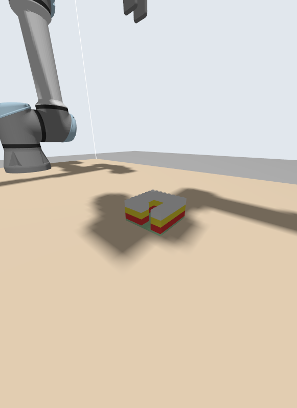

# Dual-arm LEGO assembly with two UR7e robots (ROS 2 Jazzy)

Two Universal Robots UR7e arms build **one** LEGO structure together in simulation: from an
LDraw design file to bricks seated on their studs. The build order and the split of work
between the arms are computed by a planner, not scripted.



**Latest result** (house with a doorway, 18 bricks, 3 levels): 18/18 bricks placed and
verified, no retries, max placement error 0.07 mm, 365 s simulated build time
(planned: 266 s with two arms vs. 504 s with one). Details and all measurements: [PROGRESS.md](PROGRESS.md).

## How it works

```
overhead RGB-D camera (simulated D435)
        |  /camera/color, /camera/depth, /camera/points
lego_perception          brick type / colour / pose  ->  /lego/detections
        |
lego_assembly_planner    LDraw target -> dependency graph -> feasible order
        |                -> arm assignment + schedule (greedy, OR-Tools CP-SAT)
lego_dual_arm_task       executes the plan on both arms, shared-zone arbitration
        |
lego_dualarm_grasping    pick / align / insert primitives (MoveIt 2 services + IK)
        |
Gazebo Harmonic          two UR7e + OnRobot 2FG7 grippers, one ros2_control manager
```

- **Assembly planning.** Bricks live on the LEGO lattice, so support and connectivity are
  lattice arithmetic. The planner checks every partial structure for support, connectivity
  and side-gripper clearance, chooses grasps with CP-SAT, and rejects designs that cannot be
  built. For example, a closed ring of tightly fitted bricks cannot be finished by a parallel
  side gripper.
- **Dual-arm scheduling.** Assigning bricks to arms and ordering them under precedence, one
  arm in the shared build zone at a time, is a makespan problem. A greedy list scheduler is
  the baseline and OR-Tools CP-SAT the optimiser.
- **Precise placement.** Visual-servo alignment of the held brick against the observed brick
  below, Cartesian descent to a hover pose, 1 mm IK steps down, release 0.5 mm above the
  studs, then a seated check (height, position, tilt) before the next brick.
- **Perception.** Brick poses currently come from a ground-truth backend that publishes the
  same `/lego/detections` interface a real RGB-D detector will. Real detection is a planned
  milestone.

## Packages

| package | role |
|---|---|
| `lego_msgs` | `BrickDetection`, zone arbitration services |
| `lego_dualarm_description` | workcell URDF/xacro (any UR model, default `ur7e`), grippers, overhead camera, generated brick models, worlds |
| `lego_dualarm_bringup` | launch files, controllers, Gazebo-ROS bridges, demo views |
| `lego_dualarm_moveit_config` | MoveIt 2 config: `left_arm`, `right_arm`, `both_arms` |
| `lego_gz_plugins` | GraspLock Gazebo plugin (grasp and clutch stand-in) |
| `lego_perception` | ground-truth detector, RViz brick markers |
| `lego_dualarm_grasping` | `pick_place_once` primitive, trial harnesses |
| `lego_assembly_planner` | LDraw parser, feasibility, grasp selection, schedulers |
| `lego_dual_arm_task` | `build_executor`: runs a plan on both arms, verifies the result |

## Getting started

Requires Docker (NVIDIA GPU optional; `RENDER_MODE=software` works without one) and
`python3-vcstool`.

```bash
git clone https://github.com/soumics/ur7e-dualarm-lego-assembly.git ur7_jazzy_ws
cd ur7_jazzy_ws
vcs import < dependencies.repos            # UR description/driver/simulation + OnRobot descriptions
docker compose -f docker/docker-compose.yaml up -d --build
docker compose -f docker/docker-compose.yaml exec ur7e_lego bash
# inside the container (~/ws):
colcon build --symlink-install --cmake-args -DCMAKE_BUILD_TYPE=Release
source install/setup.bash
```

Build the house:

```bash
C=experiments/configs/house_door
ros2 launch lego_dualarm_bringup demo.launch.py world_file:=$PWD/$C/world.sdf     # Gazebo + RViz
# second shell: plan (optional, plan.json is included) and build
/opt/lego_planner_venv/bin/python -m lego_assembly_planner.cli \
    src/lego_assembly_planner/models/house_door.ldr --inventory $C/inventory.json --out $C/plan.json
ros2 run lego_dual_arm_task build_executor --ros-args -p plan:=$PWD/$C/plan.json -p inventory:=$PWD/$C/inventory.json
```

New targets: export an `.ldr` from LeoCAD or BrickLink Studio, then
`python3 src/lego_assembly_planner/scripts/make_world.py <target.ldr> --out experiments/configs/<name>`.
Stop everything with `src/lego_dualarm_bringup/scripts/kill_sim.sh`.

## Status and roadmap

Done: single-arm pick and place, overhead camera and perception interface, two arms with
collision-aware planning, sub-millimetre insertion, assembly planner and dual-arm schedule.

Next: closing the gap between planned and actual build time, cooperative two-arm actions
(hold + press), real RGB-D brick detection with wrist cameras, closed-loop verification and
re-planning.

Simulation only. No real robot or camera hardware is driven by this code.

## Built on

[Universal Robots ROS 2 description, driver and Gazebo simulation](https://github.com/UniversalRobots)
(used unmodified), [OnRobot ROS 2 descriptions](https://github.com/OnRobot/onrobot-ros2),
MoveIt 2, Gazebo Harmonic, ros2_control and Google OR-Tools.

Author: Soumic Sarkar
